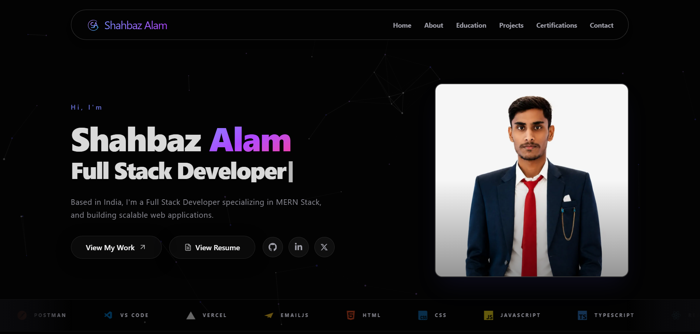

# Shahbaz Alam — Portfolio Website

A modern, animated personal portfolio built to showcase my projects, experience and skills as a Frontend Developer.

**Live Demo:** [shahbaz-alam.vercel.app](https://shahbaz-alam.vercel.app)
**Repository:** [github.com/shahbazal0m/My-Portfolio](https://github.com/shahbazal0m/My-Portfolio)



---

## Overview

This portfolio is built with **Next.js** and **Tailwind CSS v4**. It uses a dark charcoal theme with amber accents, a subtle grid background, smooth Framer Motion animations, a custom contact form API, and a few live widgets (GitHub activity and a visitor counter).

**Sections:** Hero · About · Experience · Projects · Education · GitHub Activity · Certifications · Contact · Quote of the Day · Visitor Counter

---

## Key Features

| Feature | Description |
|---|---|
| **Amber dark theme** | Charcoal base, amber accents, glass cards and a soft grid background |
| **Floating navbar** | Pill-shaped navbar that changes its blur and shadow on scroll, with an animated mobile menu |
| **Hero** | Typewriter role text and a code-window style profile frame |
| **Skills marquee** | Infinite auto-scrolling strip of languages, frameworks and tools |
| **About (bento grid)** | Tile layout with intro, stats, current stack, learning list, location and status |
| **Experience timeline** | Vertical timeline with role, dates, skills chips and certificate links |
| **Project cards** | Built from a data array, with stack icons and GitHub / live demo links |
| **GitHub activity** | Contribution heatmap plus total stars and forks from the GitHub REST API |
| **Certifications** | Certificate cards with icon tags and verification links |
| **Contact form** | Custom Next.js API route (`/api/contact`) with loading state and toast notifications |
| **Quote of the Day** | A new developer quote every day, with dots and a "next quote" button |
| **Visitor counter** | Odometer-style counter backed by an API route and Upstash Redis, counted once per browser session |
| **Scroll-to-top** | Button that appears after scrolling, with animated entrance and exit |
| **Responsive** | Layouts tuned for mobile, tablet and desktop |

---

## Tech Stack

**Frontend**
- [Next.js](https://nextjs.org/) (App Router)
- [TypeScript](https://www.typescriptlang.org/)
- [Tailwind CSS v4](https://tailwindcss.com/)
- [Framer Motion](https://www.framer.com/motion/)
- [React Hot Toast](https://react-hot-toast.com/)
- [typewriter-effect](https://www.npmjs.com/package/typewriter-effect)
- [Lucide React](https://lucide.dev/) and [React Icons](https://react-icons.github.io/react-icons/)

**Backend and APIs**
- Next.js route handlers (`/api/contact`, `/api/visitor`)
- Upstash Redis for the persistent visitor count
- GitHub REST API for repository stats

**Tools and Deployment**
- Git and GitHub
- Vercel (deploys from the `master` branch)
- VS Code

---

## Project Structure

```
.
├── app/
│   ├── api/
│   │   ├── contact/            # Contact form submissions
│   │   └── visitor/            # Visitor count
│   ├── components/
│   │   ├── navbar.tsx          # Floating responsive navbar
│   │   ├── Hero.tsx            # Landing section with typewriter text
│   │   ├── SkillsMarquee.tsx   # Auto-scrolling skills strip
│   │   ├── About.tsx           # Bento-grid About section
│   │   ├── Experience.tsx      # Experience timeline
│   │   ├── Projects.tsx        # Project cards
│   │   ├── Education.tsx       # Education cards
│   │   ├── Githubactivity.tsx  # GitHub heatmap and stats
│   │   ├── certificates.tsx    # Certifications grid
│   │   ├── Contact.tsx         # Contact form and details
│   │   ├── QuoteOfTheDay.tsx   # Daily developer quote
│   │   ├── Visitorcounter.tsx  # Visitor counter widget
│   │   ├── Background.tsx      # Grid background
│   │   ├── Divider.tsx         # Section divider
│   │   ├── Scrolltotop.tsx     # Scroll-to-top button
│   │   └── Footer.tsx          # Full-width footer
│   ├── globals.css
│   ├── layout.tsx
│   └── page.tsx
├── public/
│   ├── project-image/
│   ├── certificates-images/
│   ├── experience-images/
│   ├── profile-image/
│   └── tab-logo/
└── package.json
```

---

## Getting Started

Clone the `master` branch and run the project locally:

```bash
git clone -b master https://github.com/shahbazal0m/My-Portfolio.git
cd My-Portfolio
npm install
npm run dev
```

Open [http://localhost:3000](http://localhost:3000) in your browser.

### Environment Variables

Create a `.env.local` file in the project root. The contact form and the visitor counter need keys from their services: an email provider for `/api/contact` and Upstash Redis for `/api/visitor`.

```
# Add the keys your API routes read from process.env
```

The rest of the site runs without them. The contact form and the visitor counter will show an error state until the keys are added.

---

## Featured Projects

- **Food Ordering Web App**: responsive food delivery layout with category filters and JSON-based menu
- **E-commerce Website**: product catalog with shopping flow and REST API integration
- **Productivity Dashboard**: workspace hub with a weather widget, task list and habit tracking
- **Personal Portfolio**: this site, built with Next.js, TypeScript, Tailwind CSS and Framer Motion

---

## Contact

- **Email:** shahbazalam4842@gmail.com
- **LinkedIn:** [iamshahbaz-alam](https://www.linkedin.com/in/iamshahbaz-alam/)
- **GitHub:** [shahbazal0m](https://github.com/shahbazal0m)
- **Twitter/X:** [@shahbaz_al0m](https://x.com/shahbaz_al0m)

---

If you like this project, consider giving it a star on GitHub.